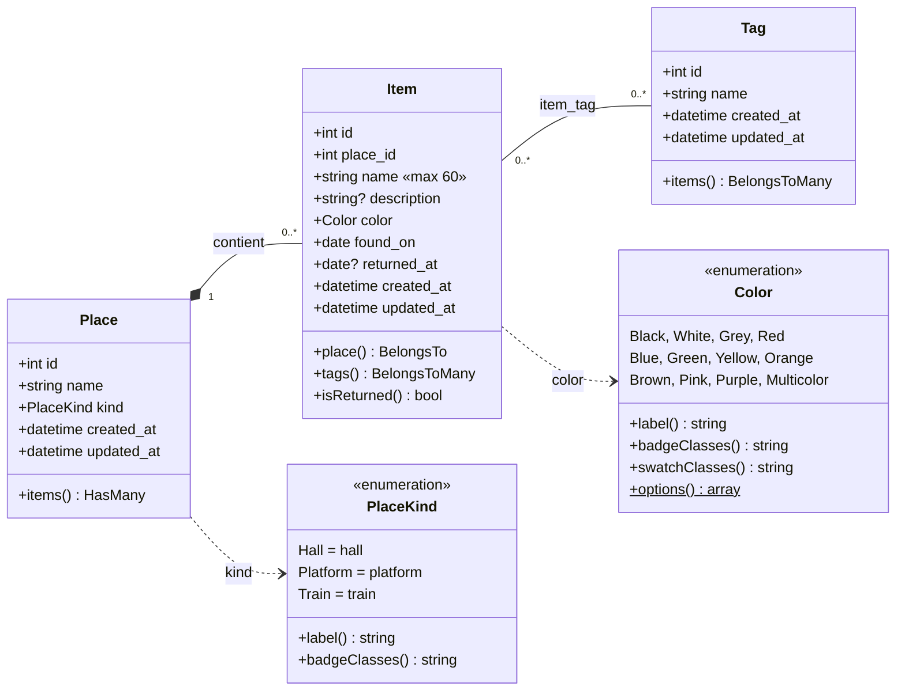

# Diagramme de classes — Perdu de vue

GitHub affiche ce diagramme Mermaid directement. Pour le rapport, on peut l'exporter en image depuis
<https://mermaid.live> (copier le bloc ci-dessous, puis *Actions → PNG*).

## Lecture

- **Place 1 — 0..\* Item**, une **composition** (losange plein) : un objet appartient à un seul lieu,
  et supprimer le lieu supprime ses objets (`cascadeOnDelete()` sur `place_id`).
- **Item 0..\* — 0..\* Tag** : plusieurs-à-plusieurs, par la table de liaison `item_tag`
  (clé primaire composée `item_id` + `tag_id`, cascade des deux côtés).
- Les enums sont stockés en texte dans la base et convertis par `casts()` dans les modèles.
